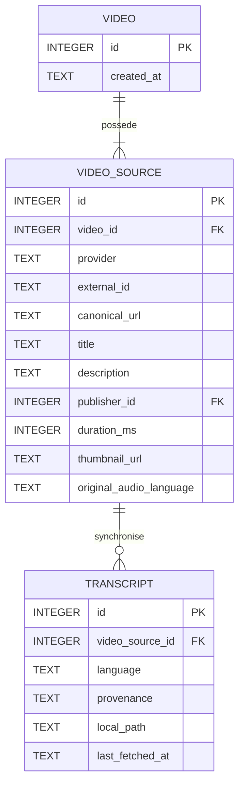

# Sillage

**Sillage** est une base de connaissances personnelle centrée sur la vidéo.
L'objectif est de transformer le visionnage d'une vidéo en connaissance durable, structurée et réutilisable : métadonnées, notes Markdown, timestamps, annotations, transcriptions, tags, captures, recherche et enrichissements IA.

> Le projet est en développement actif. Les tranches métadonnées YouTube, persistance SQLite, API HTTP, transcriptions automatiques originales, Notes + Tags et Publishers + Personnes + Tags universels sont fonctionnelles. La bibliothèque Web, l'ajout avec détection des doublons, les fiches vidéo et le classement par tags sont fonctionnels. L'étape 5.1 est terminée et validée manuellement et en CI, avec une distribution Docker opérationnelle.

## Vision

Une vidéo est un flux temporel continu. Pendant son visionnage, certaines idées, explications, images ou passages méritent d'être conservés et retrouvés plus tard.
Sillage vise à réunir ces éléments autour d'un objet `Video` stable :

```text
vidéo
  ↓
visionnage
  ↓
notes + timestamps + annotations + captures
  ↓
transcription + tags
  ↓
recherche et structuration
  ↓
connaissance exploitable
```

YouTube est la première source prise en charge, mais le modèle n'est pas limité à une plateforme particulière.

Une `Video` représente un objet de connaissance interne à Sillage. Une vidéo YouTube, un fichier local ou une autre plateforme ne sont que des sources ou représentations de cet objet.

## État actuel

Le flux persistant suivant est implémenté :

```text
URL YouTube
    ↓
AddVideo
    ↓
adapter yt-dlp
    ↓
Video + VideoSource
    ↓
SQLite
    ↓
relecture persistante
```

Sillage sait actuellement :

* recevoir une URL YouTube ;
* appeler `yt-dlp` ;
* extraire et normaliser les métadonnées utiles ;
* créer une `Video` et sa `VideoSource` ;
* les persister dans SQLite ;
* retrouver une vidéo existante à partir de l'identité de sa source ;
* conserver la même `Video` pour plusieurs formes d'URL correspondant à la même vidéo YouTube.

Il peut également acquérir, rafraîchir et relire localement la transcription
automatique originale d'une source YouTube.

Chaque vidéo peut recevoir une note Markdown principale et des tags partagés.
Leur lecture et leur modification sont locales, indépendantes des sources.
L'interface Web permet de consulter la bibliothèque et les fiches, d'ajouter une
vidéo YouTube et de retrouver un doublon. Les tags vidéo peuvent être ajoutés et
retirés dans une modale avec autocomplétion, puis utilisés pour naviguer et filtrer
la bibliothèque par un seul tag. Les descriptions des sources sont repliables.
La fiche intègre désormais l'édition Markdown, le mode Lecture GFM et une
sauvegarde protégée contre les écrasements concurrents.

La tranche 5.3 réunit désormais note, lecteur YouTube et transcription dans un
workspace responsive. Le lecteur se masque avec pause, sans reprise automatique ;
la transcription locale se consulte indépendamment, se récupère ou s'actualise
explicitement, et se regroupe par intervalles fixes de 10 secondes depuis 6.3.
Les métadonnées complètes restent accessibles dans une section repliable.
La tranche est terminée, vérifiée automatiquement et fusionnée après
les retours manuels positifs de l'utilisateur, y compris sur les correctifs
d'acquisition et de présentation. Le thème Clair / Sombre / Système utilise une
palette bleu nuit et une préférence locale au navigateur.

La tranche 6.1 ajoute les timestamps cliquables de transcription (également Entrée
ou Espace) : déplacement dans le lecteur de la même source, lecture/pause préservées
et réaffichage du lecteur masqué. Avant la première lecture ou après la fin, seul
le départ est préparé, sans lancement automatique. Si le lecteur n'est pas prêt,
un message demande un nouveau clic ; aucune commande n'est mise en attente.
La note et l'acquisition de transcription restent indépendantes. 6.1 est validée
manuellement ; le travail de l'étape 6 continue sur la même branche.

En 6.2, `+ Temps` insère en mode Édition un lien tel que
`[12:42](sillage://videos/5/sources/5?start_ms=762345)` au curseur ou après une sélection,
sans supprimer son texte. L'insertion conserve les millisecondes, rend le focus,
est annulable indépendamment et suit l'autosauvegarde normale. Le lecteur ne reçoit
aucune commande ; un lecteur masqué en pause reste masqué. Lecture, pause et fin
sont acceptées avec une position valide ; les états non démarré, cued, buffering
et indisponibles demandent de réessayer sans rien insérer. Le mode Lecture affiche
le libellé sans interaction. `videos` est l'autorité logique de l'URI ; les deux
identifiants Sillage rendent le Markdown autonome entre notes d'une même base,
sans résolution universelle entre bases. `end_ms` est réservé aux plages futures.
Citations, plages, synchronisation et navigation inverse restent hors de 6.2.

En 6.3, le champ de recherche parcourt le texte continu déjà chargé, sans casse
et sans requête réseau. Les expressions traversant fragments et blocs sont
surlignées ; compteur et précédent/suivant circulaires font défiler le résultat actif.
La recherche est littérale (accents et blancs conservés), sans occurrences
chevauchantes. Elle ne commande jamais le lecteur ; les timestamps restent
l'action explicite. Changer de vidéo/source la réinitialise. Le sélecteur
d'intervalle est supprimé : présentation fixe à 10 secondes.

L'étape 4 bis permet également de créer ou retrouver un publisher YouTube depuis
une URL de chaîne, de l'associer à une source, de gérer des personnes indépendantes
et leurs liens directs aux vidéos ou leurs publishers de référence. Le catalogue
de tags est partagé entre vidéos, publishers et personnes, sans propagation.
La navigation distingue les vidéos directement associées à une personne de celles
publiées par ses publishers, avec une union dédupliquée.

Une `Video` et ses `VideoSource` possèdent leurs propres identifiants internes Sillage.

L'identité externe d'une source repose, lorsqu'un identifiant externe existe, sur le couple :

```text
(provider, external_id)
```

Pour YouTube, deux URL telles que :

```text
https://youtu.be/IgKU8xCgbjc
https://www.youtube.com/watch?v=IgKU8xCgbjc
```

sont normalisées vers la même identité externe et retournent donc la même `Video`.

Les métadonnées d'une source déjà enregistrée ne sont pas rafraîchies implicitement par `AddVideo`.

### Flux actuel d'ajout d'une vidéo

Le handler appelle `video.Service.AddVideo`, qui extrait une source normalisée,
cherche son identité externe en base puis crée ou retrouve la vidéo.
Le résultat applicatif `AddVideoResult` contient `Video` et `Created`.

L'extraction a lieu également lors d'un ajout répété pour identifier la source :
les nouvelles métadonnées ne remplacent pas celles déjà enregistrées.
La contrainte SQL sur `(provider, external_id)` protège les créations concurrentes ;
seul l'appel qui crée effectivement la vidéo retourne `Created: true`.

## Architecture actuelle

`cmd/server` assemble le routeur Chi, les handlers HTTP, `video.Service`,
`transcript.Service`, `note.Service`, `video.TagService`, `video.PublisherService`,
`video.PersonService`, les repositories SQLite, `ytdlp.Client` et le stockage
filesystem des snapshots.

Les trois cas d'usage `AddVideo`, `GetVideo` et `ListVideos` sont réutilisables
sans HTTP, comme `transcript.Service.Fetch` et `Get`. Le cœur dépend de ports
spécialisés de lecture, acquisition, snapshots et persistance.
Les DTO JSON appartiennent à l'adaptateur HTTP ; le modèle
métier ne porte aucun tag JSON.

## Modèle de données actuel

Le schéma persistant contient les vidéos, leurs sources, les transcriptions,
les notes, les tags, les publishers et les personnes. Le diagramme ci-dessous détaille la partie acquisition ;
les tables de connaissance utilisateur sont décrites à sa suite.



La migration `0003_notes_tags.sql` complète ce schéma sans perte des données existantes :

| Table | Identité et contenu |
| --- | --- |
| `notes` | `video_id` clé primaire et étrangère, `content_md`, `created_at`, `updated_at` |
| `tags` | `id` généré, `name` affiché, `identity_key` unique |
| `video_tags` | clé primaire composée `(video_id, tag_id)`, deux clés étrangères |

La migration `0004_publishers_persons.sql` supprime `creator` et ajoute
`video_sources.publisher_id`, facultatif, ainsi que :

| Table | Identité et contenu |
| --- | --- |
| `publishers` | `id`, `provider`, `external_id` unique par provider, `name` nullable, `person_id` nullable |
| `persons` | `id`, `name` obligatoire, homonymes autorisés |
| `video_persons` | clé composée `(video_id, person_id)`, sans rôle |
| `publisher_tags` | clé composée `(publisher_id, tag_id)` |
| `person_tags` | clé composée `(person_id, tag_id)` |

Toutes les associations ont des clés étrangères. Le nom de chaîne n'est stocké
que dans le publisher. Les métadonnées ne créent jamais de personne automatiquement.

`Video.id` et `VideoSource.id` sont des identifiants internes Sillage.

`VideoSource.external_id` appartient à l'espace de noms défini par son `provider`.

Lorsqu'un `external_id` existe :

```text
(provider, external_id)
```

est unique.

Le modèle métier prévoit plus tard d'autres objets tels que :

* `Annotation` ;
* `Asset` ;
* `MediaFile`.

Ils ne sont volontairement pas représentés dans ce schéma, car ils ne sont pas encore persistés.

Le modèle conceptuel complet est documenté dans [`docs/02-domain-model.md`](docs/02-domain-model.md).

## Architecture cible

Les futures interfaces doivent utiliser le même cœur applicatif.

```mermaid
flowchart TD
    Web["Web UI"] --> REST["REST / Chi"]
    REST --> Services["Application Services"]

    MCP["MCP"] --> Services
    CLI["CLI"] --> Services
    Desktop["Futur desktop"] --> Services

    Services --> Ports["Ports"]
    Ports --> Adapters["Adapters"]

    Adapters --> SQLite["SQLite"]
    Adapters --> Ytdlp["yt-dlp"]
    Adapters --> Ffmpeg["ffmpeg"]
    Adapters --> Filesystem["Filesystem"]
    Adapters --> AI["IA"]
````

REST, MCP, le CLI et une éventuelle application desktop doivent appeler les mêmes services applicatifs.
Les interfaces externes et dépendances techniques restent des adapters autour du cœur.

## Fonctionnalités envisagées

### Bibliothèque vidéo

L'ajout YouTube, les métadonnées, la navigation et le classement par tags sont
disponibles dans l'interface Web. La recherche reste à développer.

* ajout d'une vidéo depuis une URL YouTube ;
* récupération automatique des métadonnées ;
* navigation par miniatures ;
* tags et filtre unique par tag ;
* recherche.

### Espace de travail vidéo

La page d'une vidéo doit devenir un véritable espace de travail :

* lecteur vidéo ;
* notes Markdown ;
* insertion rapide du timestamp courant ;
* navigation depuis un timestamp vers le passage correspondant ;
* annotations temporelles structurées ;
* consultation de la transcription ;
* captures d'écran liées à un timestamp.

Exemple de prise de notes :

```markdown
[12:42] Comparer cette approche avec le fonctionnement de SQLite.
```

La dimension temporelle est un élément métier de premier ordre : timestamps de notes, annotations, segments de transcription et captures doivent pouvoir être reliés précisément à la vidéo.

### Transcriptions YouTube

Le flux complet est implémenté : découverte yt-dlp, sélection de la caption
automatique originale, téléchargement JSON3, validation, snapshot local,
persistance SQLite et restitution REST.

Une transcription appartient à une `VideoSource`, dont elle partage la timeline.
Son identité est `(video_source_id, language, provenance)`. La langue métier
est celle du contenu (`en`, `pt-BR`), sans le suffixe technique `-orig`.
La provenance de cette tranche est `youtube_auto`.

`VideoSource.original_audio_language` est facultative et n'est pas exposée
dans le JSON vidéo. L'adapter utilise les formats audio explicitement marqués
originaux par yt-dlp (`language_preference = 10`). Une piste audio simplement
« default » ou une caption `*-orig` ne suffit pas. L'acquisition ne modifie
jamais la langue audio, même inconnue. Les anciennes valeurs restent conservées.

La langue audio enregistrée donne priorité à sa clé `<langue>-orig` admissible.
À défaut, une forme simple langue-région (région de deux lettres ou trois chiffres)
cible sa clé générique ; les étiquettes complexes ne sont pas simplifiées.
Sinon, un seul candidat `-orig` proposant JSON3 et une URL HTTPS valide est
accepté, même dans une autre langue. Plusieurs formats d'une clé ne sont pas
plusieurs pistes. Aucun candidat signifie indisponibilité ; plusieurs candidats
sans correspondance exacte ou régionale signifient ambiguïté. La redétection audio ne
départage pas les pistes. Aucune traduction de captions n'est demandée ; les captions
manuelles et le STT restent exclus. Une piste `-orig` peut transcrire un doublage : cette politique
privilégie l'audio original sans le garantir, notamment lors du repli unique.

JSON3 reste dans l'adapter. Le domaine utilise seulement :

```go
type TranscriptItem struct {
    StartMS int64
    Text    string
}

type TranscriptContent []TranscriptItem
```

Le parser conserve l'ordre source et les espaces des fragments. Il matérialise
une séparation entre événements autonomes si aucun blanc ne les sépare déjà ;
un événement JSON3 `aAppend` prolonge le précédent. Les événements sans texte
sont ignorés ; un texte sans temps valide, des offsets invalides ou un document
sans contenu exploitable sont rejetés. Les offsets absents valent zéro.
Aucune durée de fin ni segmentation par mots n'est inférée.

`TranscriptContent.PlainText()` concatène puis normalise les blancs.
Le texte brut n'est pas persisté. Les fragments ne deviennent pas des lignes SQL.

Chaque acquisition réussie conserve actuellement le JSON3 dans
`data/transcripts/`. SQLite contient un chemin relatif à cette racine.
Un nouveau fichier complet est publié avant la transaction SQL ; un échec
ne remplace ni le chemin courant ni sa date. Les fichiers précédents et les
éventuels fichiers orphelins après échec/crash ne sont pas automatiquement
supprimés pendant cette phase, afin de préserver les lectures concurrentes.
Ce mécanisme n'expose aucun historique métier. La politique durable de rétention
et de nettoyage reste ouverte.

Les téléchargements utilisent un répertoire temporaire supprimé en fin d'appel.
Le dump yt-dlp de découverte n'y reste que le temps du téléchargement, via
`--load-info-json`, pour conserver exactement la piste sélectionnée.
Le JSON3 est limité à 16 Mio, le dump de découverte à 64 Mio et stderr à 16 Kio.

### Recherche

La recherche doit à terme pouvoir couvrir :

* titres ;
* descriptions ;
* tags ;
* notes ;
* transcriptions ;
* résumés et autres artefacts textuels.

SQLite FTS5 est privilégié pour la future recherche plein texte.

Lorsqu'un résultat provient d'un contenu temporel, Sillage doit idéalement pouvoir ouvrir directement la vidéo au bon timestamp.

### IA et MCP

Sillage est conçu pour être **IA-native**, tout en restant pleinement utilisable sans IA.

Des agents pourront à terme interroger et modifier la base via MCP avec des outils métier tels que :

```text
search_videos
get_video
get_transcript
get_annotations
add_tags
append_note
```

Ils ne doivent pas être exposés à des primitives techniques telles que :

```text
execute_sql
run_ytdlp_command
```

Exemple d'usage :

> Recherche mes vidéos sur Proxmox et Tailscale et indique lesquelles parlent du subnet routing.

## Stack technique

Choix actuels ou privilégiés :

* **Go**
* `net/http`
* **Chi**
* **SQLite**
* `database/sql`
* `modernc.org/sqlite`
* migrations SQL embarquées avec `embed.FS`
* `PRAGMA user_version`
* SQLite **FTS5** à terme
* **yt-dlp**
* **ffmpeg**
* **Docker**
* API REST
* MCP en Go à terme

React, TypeScript et Vite sont utilisés pour une SPA consommant l'API REST,
avec React Router pour la navigation. Go sert déjà les fichiers compilés en
production locale, sans serveur Node.js permanent. Ils sont également distribués avec le
binaire dans une même image Docker. L'accès reste
local par défaut.
CodeMirror 6 est intégré directement pour l'édition ; react-markdown et remark-gfm
assurent la lecture GFM sans interprétation du HTML brut. Les autres bibliothèques
seront choisies selon les besoins.

Une version desktop reste envisageable, mais sa technologie n'est pas arrêtée.

## SQLite

La persistance actuelle utilise :

```text
database/sql
+
modernc.org/sqlite
```

Le schéma est initialisé automatiquement au démarrage à partir de migrations SQL embarquées.

Le système de migrations utilise :

```text
embed.FS
+
PRAGMA user_version
```

Les migrations sont :

* versionnées ;
* forward-only ;
* appliquées dans l'ordre ;
* transactionnelles.

La configuration actuelle active également :

```text
foreign_keys = ON
busy_timeout ≈ 5000 ms
```

Le mode WAL n'est pas activé pour l'instant.

### Mise à niveau vers l'étape 4 bis

Arrêter les anciens processus avant de lancer le nouveau serveur. Pour une base
en version 1 à 3, l'ouverture crée automatiquement une sauvegarde SQLite complète
voisine, nommée `sillage.db.before-publishers-<suffixe>.bak`, puis applique les
migrations. Si la sauvegarde échoue, l'ouverture échoue avant la migration.

Les anciens libellés `creator` sont supprimés de la base migrée et restent dans
la sauvegarde. Aucune identité n'est déduite de ces noms : les sources existantes
commencent sans publisher. Les autres données et leurs identifiants sont conservés.
Le rattachement ultérieur est explicite ; réajouter une vidéo ne le réalise pas.
Les sauvegardes ne sont ni écrasées ni nettoyées automatiquement.

## Exécution

### Prérequis

* Go 1.27.1 ;
* `yt-dlp` accessible dans le `PATH`.

Lancer le serveur depuis le répertoire de travail souhaité :

```bash
go run ./cmd/server
```

| Variable d'environnement | Défaut |
| --- | --- |
| `SILLAGE_HTTP_ADDR` | `127.0.0.1:8080` |
| `SILLAGE_POST_TIMEOUT` | `60s` |
| `SILLAGE_WEB_DIR` | absent : API seule |

Le timeout accepte une durée Go strictement positive, par exemple `90s`.
Le chemin de base est fixe : `data/sillage.db`, relatif au répertoire de travail
du processus. Son dossier parent est créé s'il manque. Une ancienne base à la
racine n'est ni déplacée ni importée automatiquement. Le conteneur utilise
`WORKDIR /app` avec un bind mount sur `/app/data`.

Les dates SQLite utilisent UTC avec une précision milliseconde fixe
(`YYYY-MM-DDTHH:MM:SS.mmmZ`). Le schéma initial a été réinitialisé pendant
le développement : les anciennes bases utilisant `created_at_ms` ne sont
pas compatibles. Serveur arrêté, déplacer `data/sillage.db` hors de ce
chemin puis redémarrer recrée une base vide ; aucun ancien contenu n'est importé.

Le serveur n'active ni authentification ni CORS. L'adresse d'écoute est configurable.
Le packaging Docker est décrit ci-dessous.

Le POST est synchrone. Après décodage du corps, un contexte limité par
`SILLAGE_POST_TIMEOUT` est propagé jusqu'au processus d'extraction et à SQLite.
`http.Server` limite la lecture des en-têtes à 5 s, la lecture de la requête à
15 s et l'inactivité entre requêtes à 60 s. `WriteTimeout` reste désactivé pour
permettre l'envoi du JSON d'erreur après expiration du timeout applicatif.
L'arrêt sur interruption ou SIGTERM annule les traitements, arrête le serveur,
puis ferme SQLite.

### Distribution Docker — Linux AMD64

Le jalon 4 et l'ensemble de l'étape 5.1 sont terminés et validés manuellement
et en CI. Docker Compose a été validé sous WSL2, y compris l'import YouTube réel,
les doublons, les tags, les accès directs et la persistance après recréation.
Les données Docker sont conservées séparément de celles du développement local.
Docker Engine avec Compose v2, ou Docker Desktop intégré à WSL2, suffit :
Go, Node, Python, yt-dlp et ffmpeg n'ont pas à être installés sur l'hôte.
Exécuter les commandes depuis la racine du dépôt sous Linux/WSL. Sous WSL,
privilégier un répertoire du filesystem Linux pour les données et les permissions.

**Premier démarrage :**

```bash
export SILLAGE_DATA_DIR="$HOME/.local/share/sillage"
export SILLAGE_UID="$(id -u)"
export SILLAGE_GID="$(id -g)"
export SILLAGE_PORT=8080
mkdir -p "$SILLAGE_DATA_DIR"
chmod 700 "$SILLAGE_DATA_DIR"
docker compose -f deployments/docker/compose.yaml up -d --build
```

Choisir un répertoire dédié. Compose exige un chemin de données existant ;
il ne le crée pas implicitement en root. Le processus non-root utilise les
UID/GID numériques indiqués (1000:1000 par défaut). Le répertoire et son contenu
doivent appartenir à cet utilisateur ou lui donner les droits nécessaires.
Sur un serveur, préparer ces droits une seule fois avec l'administrateur.
Ne pas utiliser UID 0 ni rendre les données accessibles à tous pour contourner
une erreur de permissions. Les mêmes variables doivent être conservées pour
les commandes suivantes. On peut aussi placer la configuration dans
`deployments/docker/.env`, à côté de `compose.yaml`. Ce fichier local est déjà
ignoré par Git. Exemple à adapter au répertoire et aux UID/GID de l'utilisateur :

```dotenv
SILLAGE_DATA_DIR=/home/patrick/.local/share/sillage
SILLAGE_UID=1000
SILLAGE_GID=1000
SILLAGE_PORT=8080
```

`SILLAGE_DATA_DIR` est obligatoire et doit contenir un chemin absolu vers le
répertoire préparé. Les trois autres variables sont facultatives : UID et GID
valent chacun `1000` par défaut, et le port hôte vaut `8080`. Utiliser `id -u`
et `id -g` pour connaître les valeurs adaptées à l'hôte ; le fichier contient
leurs valeurs numériques, pas des commandes shell.

Depuis la racine du dépôt, vérifier la configuration effective avant le lancement :

```bash
docker compose -f deployments/docker/compose.yaml config
```

Les variables déjà exportées dans le terminal sont prioritaires sur le `.env`.
Un `.env` présent dans le répertoire courant peut également prendre priorité
sur celui du Compose ; pour choisir explicitement le fichier, ajouter
`--env-file deployments/docker/.env` à la commande `docker compose`.
Le chargement par Compose ne définit pas les variables du shell : pour les
commandes `mkdir`, `chmod` et `tar` de ce guide, exporter aussi
`SILLAGE_DATA_DIR` ou utiliser directement le même chemin absolu.

Ouvrir <http://127.0.0.1:8080> (ou le port choisi). L'API est accessible sous
`/api/v1`. Le serveur écoute sur `0.0.0.0:8080` dans le conteneur, mais Compose
publie uniquement sur `127.0.0.1` de l'hôte. Sillage n'a pas d'authentification.
En usage Docker direct, conserver cette restriction avec
`-p 127.0.0.1:8080:8080`, le bind mount vers `/app/data` et `--user UID:GID`.

```bash
docker compose -f deployments/docker/compose.yaml logs -f
docker compose -f deployments/docker/compose.yaml stop
docker compose -f deployments/docker/compose.yaml start
docker compose -f deployments/docker/compose.yaml up -d --force-recreate
docker compose -f deployments/docker/compose.yaml down
```

Arrêts et recréations conservent le répertoire hôte. Le délai d'arrêt Compose
est de 15 s pour laisser au serveur ses 10 s de shutdown gracieux.
`SILLAGE_POST_TIMEOUT` configure la durée maximale d'acquisition (défaut `60s`).
Les caches et fichiers temporaires des outils restent éphémères sous `/tmp`.
Les exécutables appartiennent à root et ne sont pas modifiables par Sillage.

**Sauvegarde, restauration et déplacement à froid :**

Arrêter toutes les instances utilisant les données. Copier tout le répertoire,
pas seulement `sillage.db` : il contient aussi les snapshots de transcription
et peut contenir les fichiers auxiliaires SQLite.

```bash
docker compose -f deployments/docker/compose.yaml stop
tar -C "$SILLAGE_DATA_DIR" -czf "$HOME/sillage-backup-$(date +%Y%m%d-%H%M%S).tar.gz" .
docker compose -f deployments/docker/compose.yaml start
```

Pour restaurer, arrêter le conteneur, extraire l'archive dans un **nouveau
répertoire vide** appartenant à l'utilisateur choisi, puis configurer ce chemin
dans `SILLAGE_DATA_DIR` et exécuter `up -d --force-recreate`. Conserver l'ancien
répertoire jusqu'à validation. Pour déplacer les données vers un autre hôte,
appliquer la même procédure et adapter UID/GID au propriétaire sur cet hôte.

Pour reprendre les données de développement, arrêter d'abord `make run`,
copier **l'ensemble** de `data/` vers le répertoire dédié vide, puis démarrer
Compose avec ce chemin. Aucune migration automatique n'est effectuée.
Le backend lancé avec `make run` et le conteneur ne doivent jamais utiliser
simultanément la même base SQLite.

**Reconstruction et mises à jour :**

```bash
docker compose -f deployments/docker/compose.yaml build --pull --no-cache
docker compose -f deployments/docker/compose.yaml up -d --force-recreate
```

Le Dockerfile fixe les versions Go/Node, les digests des images de base et les
versions/empreintes de yt-dlp et Deno. Les paquets Debian reçoivent les correctifs
disponibles au moment de la reconstruction ; le build n'est donc pas garanti
identique octet pour octet. Actualiser explicitement les digests pour faire
évoluer les images de base. Sauvegarder les données avant une mise à jour de
Sillage et conserver l'ancienne image si un retour arrière est nécessaire.

yt-dlp stable `2026.08.19` et Deno `2.9.7` sont intégrés. Pour reconstruire avec
une autre version de yt-dlp, choisir un tag précis et relever l'empreinte de
`yt-dlp_linux` dans les `SHA2-256SUMS` de la release officielle. Les paramètres
sont `YTDLP_REPOSITORY`, `YTDLP_VERSION` et `YTDLP_SHA256` :

```bash
# Définir au préalable VERSION et SHA256 avec le tag et son empreinte vérifiée.
docker compose -f deployments/docker/compose.yaml build \
  --build-arg YTDLP_REPOSITORY=yt-dlp/yt-dlp \
  --build-arg YTDLP_VERSION="$VERSION" \
  --build-arg YTDLP_SHA256="$SHA256"
docker compose -f deployments/docker/compose.yaml up -d --force-recreate
```

Pour une nightly corrective, utiliser `yt-dlp/yt-dlp-nightly-builds` et le tag
**précis** de sa release avec sa propre empreinte, jamais `latest`.
Les [releases stables](https://github.com/yt-dlp/yt-dlp/releases) et
[nightly](https://github.com/yt-dlp/yt-dlp-nightly-builds/releases) fournissent
ces fichiers. Une empreinte erronée fait échouer le build. Deno dispose des
paramètres analogues `DENO_VERSION` et `DENO_SHA256`.
Il n'y a ni auto-update au démarrage ni mise à jour depuis l'interface.
Un exécutable externe persistant sélectionné volontairement, avec la version
intégrée comme repli, reste une question ouverte.

**Vérification de la distribution :**

```bash
docker build --platform linux/amd64 -f deployments/docker/Dockerfile -t sillage:local .
python3 tests/docker/smoke.py
```

Le script requiert Python 3 et un utilisateur hôte non-root. Il teste les outils
réels hors réseau, puis Compose avec une acquisition simulée : HTTP/SPA,
permissions, publication localhost, SQLite, tags, fichier persistant, recréation
et arrêt propre. Il utilise exclusivement un répertoire temporaire, supprimé
après retrait des conteneurs de test. La CI Docker exécute ce parcours depuis
un checkout propre, indépendamment de Go/Postman/Playwright. L'acquisition
YouTube réelle a été validée manuellement sous WSL2 ; elle reste exclue de la CI.

### Interface Web — étape 5.1, jalons 1 à 3

Les jalons 1, 2 et 3 sont terminés, testés automatiquement et validés manuellement.
Le jalon 4 — distribution Docker et consolidation — est également validé.
Les trois jobs GitHub Actions Go/Postman, Web/Playwright et Docker ont réussi.

Disponible : bibliothèque connectée à REST, ajout YouTube, détection des
doublons et fiches vidéo. Les cartes ouvrent `/videos/{id}` avec l'ID interne
Sillage ; `/videos/new` permet l'ajout. React Router gère la navigation et
l'historique. Accès direct, rechargement et retour à la bibliothèque sont pris
en charge par le build servi par Go comme par le serveur Vite.

Le formulaire distingue création (201) et vidéo déjà présente (200), puis
propose d'ouvrir la fiche retournée. Une seule acquisition synchrone est lancée
à la fois, sans relance automatique ni timeout client plus court que le serveur.
Les erreurs de validation, d'acquisition et de délai sont traduites par leur
code REST ; la saisie est conservée. Quitter la page annule la requête cliente
et ignore sa réponse tardive, sans garantir l'annulation d'un enregistrement
déjà effectué. Après une coupure réseau, vérifier la bibliothèque ou réessayer :
le backend conserve sa déduplication existante.

La fiche affiche les métadonnées de toutes les sources, leurs publishers,
durées, descriptions en texte brut et liens HTTP(S), ainsi que les tags directs
de la vidéo. Le titre d'en-tête utilise provisoirement la première source.
La date affichée est celle de l'ajout dans Sillage, pas celle de publication.
Les personnes ne sont pas déduites des publishers. L'éditeur de notes est décrit
dans la section 5.2 ci-dessous ; aucun lecteur ni panneau de transcription
n'est introduit.

Les tags de la fiche ouvrent la bibliothèque filtrée (`/?tag_id=7`). Le retour
à une bibliothèque filtrée conserve ce contexte ; un accès direct à une fiche
revient à la bibliothèque complète. Les tags des cartes restent non interactifs.

**Gérer les tags** (ou **Ajouter des tags**) ouvre une modale provisoire.
Le champ unique propose les tags existants et permet un ajout par nom :
flèches pour parcourir, Entrée pour associer, Échap pour fermer les propositions,
puis la modale. Les ajouts/retraits sont enregistrés immédiatement. Fermer la
modale n'annule pas une opération ; quitter la fiche ignore ses réponses tardives.
**Actualiser les associations** relit les données en cas de doute ou de modification
dans un autre onglet. La normalisation et les noms affichés viennent du backend.
Une seule mutation est exécutée à la fois ; aucune synchronisation entre onglets.

Le filtre utilise le catalogue complet, y compris les tags sans vidéo associée.
Un résultat vide ne signifie pas que toute la bibliothèque est vide.
Les descriptions sont intégrales et repliées initialement, indépendamment pour
chaque source. Le futur volet de gestion et un panneau de métadonnées restent
des pistes UX, sans composants anticipés.

Le packaging Docker du jalon 4 réutilise ce même build.
La chaîne de production fonctionne déjà sans Vite à l'exécution.

Prérequis supplémentaires : Node.js 24 (24.20.0 validé), npm et Make.
Exécuter sous Linux/WSL depuis la racine du dépôt, avec Go dans le PATH.

**Production locale :**

```bash
make web-install
make build
make run
```

Ouvrir <http://127.0.0.1:8080>. Le serveur utilise la bibliothèque existante
`data/sillage.db`. `make run` lance le binaire compilé et sert `web/dist`.
Après une modification du code, relancer `make build` puis le serveur.

`SILLAGE_WEB_DIR` active explicitement le frontend et désigne son répertoire
compilé, relatif au répertoire de travail ou absolu. Sans cette variable,
le serveur conserve son fonctionnement API seul ; un chemin configuré absent
ou sans `index.html` fait échouer le démarrage. Le répertoire public doit
contenir uniquement le build frontend, jamais `data/`.

**Développement, dans deux terminaux :**

```bash
make dev-api
```

```bash
make web-dev
```

Ouvrir <http://127.0.0.1:5173>. Vite relaie `/api` vers
`127.0.0.1:8080`, sans CORS. Les ports sont fixes pour éviter de viser
accidentellement une autre instance ; arrêter le serveur de production avant
de lancer l'API de développement. Les commandes restent entièrement sous WSL.

**Validation automatisée :**

```bash
make test
cd web
npx playwright install --with-deps chromium
cd ..
make test-web
python3 tests/postman/run.py deterministic
```

L'installation des dépendances système Chromium peut demander les droits
administrateur sous Linux ; elle ne concerne que les tests navigateur.
Playwright teste le build servi par le vrai binaire Go, sur le port 18381,
avec une base temporaire. Un double ciblé de yt-dlp fournit des métadonnées
fixes uniquement dans ce processus de test. Les données initiales sont ajoutées
par REST puis le serveur redémarre avant le test de lecture. Le navigateur
effectue aussi un ajout et un doublon via Go/SQLite. Aucun accès YouTube ni
donnée personnelle. Le parcours tags associe un même tag à deux vidéos,
vérifie la normalisation côté Go, filtre la bibliothèque puis retire une
association sans modifier l'autre. Les scénarios de transport couvrent erreurs,
réponses tardives et fermeture pendant une mutation ; les tests clavier couvrent
les suggestions et le focus du dialogue.
Les états vide/erreur et les variantes de métadonnées utilisent des réponses
simulées dans le navigateur, séparément de ce parcours d'intégration.

**Essai manuel du jalon 2 :**

1. Lancer l'application avec le vrai `yt-dlp` dans le PATH, puis ouvrir la
   bibliothèque et choisir **Ajouter une vidéo**.
2. Saisir une URL YouTube publique non encore enregistrée. Pendant l'acquisition,
   le bouton et le champ sont désactivés. Attendre **Vidéo ajoutée**, puis choisir
   **Ouvrir la fiche**.
3. Vérifier titre, source, compte de publication, durée et lien externe, puis
   déplier la description ; les données absentes doivent rester compréhensibles.
4. Revenir à la bibliothèque et ouvrir la carte. Tester précédent/suivant,
   rechargement et ouverture de l'URL de fiche dans un nouvel onglet.
5. Ajouter à nouveau la même URL : le message **déjà présente** mène à la même
   fiche et aucune nouvelle carte n'est créée.
6. Arrêter le serveur (Ctrl+C), puis relancer `make run` depuis le même dossier.
   Rouvrir la fiche : elle est lue dans SQLite sans nouvelle acquisition.
7. Essayer `https://example.com/video` dans le formulaire : l'erreur de
   validation conserve la saisie et permet de la corriger. Les erreurs distantes
   et timeouts sont couverts de façon déterministe dans Playwright.
8. Ouvrir `/videos/999999999` (ID absent), `/videos/invalide` et
   `/page-inconnue`, puis revenir à la bibliothèque. Les erreurs API et
   `/assets/inconnu.js` restent séparées de la SPA.
9. Réduire la fenêtre et parcourir les cartes/liens au clavier.

**Essai manuel du jalon 3 :**

1. Ouvrir une fiche, cliquer sur **Gérer les tags**, saisir un nouveau nom
   et choisir son ajout. Vérifier que la saisie est vidée et garde le focus.
2. Sur une seconde vidéo, saisir le début de ce nom et choisir la suggestion
   avec les flèches puis Entrée. Fermer la modale : le tag reste visible.
3. Cliquer sur le tag : la bibliothèque filtrée doit montrer les deux vidéos.
   Recharger, essayer précédent/suivant et changer le filtre avec le sélecteur.
4. Ouvrir une carte puis revenir à la bibliothèque : le filtre est conservé.
   Une fiche ouverte directement peut revenir à la bibliothèque complète.
5. Retirer le tag de la première vidéo dans la modale : la seconde doit rester
   associée et visible sous ce filtre. Retirer le filtre retrouve toute la liste.
6. Après retrait de la dernière association, le tag reste disponible dans le
   catalogue ; son filtre affiche un état vide explicite.
7. Arrêter et relancer `make run` depuis le même dossier : les associations
   restantes et les retraits sont conservés.
8. Vérifier les descriptions fermées initialement, leur ouverture indépendante
   et le clavier de la modale (Tab, flèches, Entrée, Échap), sur écran étroit aussi.

### Contrat API v1

```bash
curl -i http://127.0.0.1:8080/api/v1/videos \
  -H 'Content-Type: application/json; charset=utf-8' \
  --data '{"url":"https://www.youtube.com/watch?v=IgKU8xCgbjc"}'

curl http://127.0.0.1:8080/api/v1/videos
curl http://127.0.0.1:8080/api/v1/videos/42
```

`POST /api/v1/videos` exige le type MIME `application/json`, avec paramètres
éventuels, et accepte un seul objet `{"url":"…"}` de 16 Kio maximum.
L'URL est obligatoire ; les champs inconnus et le contenu JSON supplémentaire
sont rejetés.

- Création : `201 Created`, avec `Location: /api/v1/videos/{id}`.
- Vidéo déjà présente : `200 OK`, sans `Location` et sans refresh.

Les deux réponses et `GET /api/v1/videos/{id}` utilisent exactement la même
représentation :

```json
{
  "id": 42,
  "created_at": "2026-09-10T18:30:12.123Z",
  "sources": [
    {
      "id": 17,
      "provider": "youtube",
      "external_id": "IgKU8xCgbjc",
      "canonical_url": "https://www.youtube.com/watch?v=IgKU8xCgbjc",
      "title": "Strategies for programming with AI agents | DHH and Lex Fridman",
      "description": null,
      "publisher": {"id": 7, "name": "Lex Clips"},
      "duration_ms": 1025000,
      "thumbnail_url": null
    }
  ],
  "tags": [],
  "person_ids": []
}
```

Les dates sont en UTC / RFC 3339 avec leur précision disponible. Les sources
sont ordonnées par ID croissant et n'exposent pas `video_id`.
Les champs optionnels absents valent `null`, y compris `external_id` et
`canonical_url` dans le modèle générique. Une durée connue de zéro reste `0`.

**Rupture de contrat de l'étape 4 bis :** `creator` est supprimé de `/api/v1`,
sans alias. Chaque source expose `publisher`, soit `null`, soit un objet contenant
uniquement `id` et `name`. Le nom vaut `null` s'il est inconnu. Aucun champ
`publisher_id` supplémentaire n'est exposé dans cette réponse.
`person_ids` contient uniquement les personnes directement associées à la vidéo,
par ID croissant ; les relations indirectes par publisher ne sont pas matérialisées.

`GET /api/v1/videos` retourne `{"videos":[…]}`, avec la même représentation
pour chaque vidéo. L'ordre est `created_at DESC, id DESC`, sans pagination
ni limite implicite. Une bibliothèque vide retourne `200` et `{"videos":[]}`.

### Erreurs API

```json
{
  "error": {
    "code": "video_not_found",
    "message": "video not found"
  }
}
```

Les codes sont stables ; les messages lisibles en anglais peuvent évoluer.

| Statut | Code | Situation |
| --- | --- | --- |
| 400 | `bad_request` | Corps, URL ou identifiant invalide |
| 404 | `video_not_found` | Vidéo absente |
| 413 | `payload_too_large` | Corps supérieur à 16 Kio |
| 415 | `unsupported_media_type` | Type de contenu absent, invalide ou différent de JSON |
| 502 | `metadata_fetch_failed` | Échec d'extraction ou métadonnées inexploitables |
| 504 | `metadata_fetch_timeout` | Délai applicatif dépassé |
| 500 | `internal_error` | Problème local d'exécution, persistance ou autre erreur interne |

L'adaptateur valide déjà les hôtes YouTube et signale un refus explicite par
`400 bad_request`. Les erreurs non classifiées d'extraction donnent `502`,
sans interprétation de chaînes stderr. Aucun `422 video_unavailable` n'est
introduit. Les détails techniques restent dans les logs. La déconnexion du client
annule le traitement sans réponse particulière.

### API des transcriptions

```text
POST /api/v1/videos/{video_id}/sources/{source_id}/transcript
GET  /api/v1/videos/{video_id}/sources/{source_id}/transcript
```

Le POST sans corps acquiert ou rafraîchit la caption automatique originale.
Aucun `Content-Type` n'est requis ; un corps non vide est rejeté par `400 bad_request`.
Il retourne toujours `200 OK`, sans `Location`, après publication et persistance.
Le délai global `SILLAGE_POST_TIMEOUT` couvre toute l'acquisition.

Le GET ne fait aucun accès distant. Il sélectionne la dernière acquisition
`youtube_auto` par `last_fetched_at DESC, id DESC`, puis parse le snapshot local.
Une ligne dont le snapshot est absent, illisible ou corrompu donne `500 internal_error`.
Le service vérifie la vidéo et l'appartenance de la source avant tout accès au contenu.

GET et POST exposent exactement les mêmes champs :

```json
{
  "language": "en",
  "provenance": "youtube_auto",
  "last_fetched_at": "2026-10-07T14:21:35.042Z",
  "items": [
    {"start_ms": 2960, "text": "This"},
    {"start_ms": 3080, "text": " is"}
  ]
}
```

L'ID du transcript, `video_source_id` et `local_path` restent internes.
Il n'existe pas de ressource autonome `/api/v1/transcripts`.

| Statut | Code | Situation |
| --- | --- | --- |
| 400 | `bad_request` | Identifiant invalide ou corps non vide |
| 404 | `video_not_found` | Vidéo inexistante |
| 404 | `video_source_not_found` | Source absente ou appartenant à une autre vidéo |
| 404 | `transcript_not_found` | Aucune acquisition pour la politique actuelle |
| 404 | `transcript_not_available` | Aucune piste originale JSON3 sélectionnable de façon fiable |
| 409 | `transcript_selection_ambiguous` | Plusieurs pistes originales admissibles sans correspondance exacte ou régionale avec la langue audio enregistrée |
| 502 | `transcript_fetch_failed` | Échec distant ou contenu distant inexploitable |
| 504 | `transcript_fetch_timeout` | Délai applicatif dépassé |
| 500 | `internal_error` | Erreur locale : exécutable indisponible, SQLite, filesystem, snapshot |

Les échecs de processus ne sont pas interprétés en analysant le texte de stderr.
Une déconnexion annule l'opération sans réponse particulière. Un commit déjà
réussi peut néanmoins précéder une déconnexion ; le client peut alors relire le GET.

### API des notes et tags

Ces routes sont disponibles depuis l'étape 4, sans accès distant :

| Méthode | Endpoint | Succès |
| --- | --- | --- |
| `GET` | `/api/v1/videos/{id}/note` | `200`, note principale |
| `PUT` | `/api/v1/videos/{id}/note` | `201` à la création, `200` ensuite |
| `GET` | `/api/v1/tags` | `200`, catalogue incluant les tags inutilisés |
| `POST` | `/api/v1/videos/{id}/tags` | `200`, ajout additif puis tous les tags associés |
| `DELETE` | `/api/v1/videos/{id}/tags/{tag_id}` | `204`, même si l'association est absente |

Exemples pour une vidéo existante :

```bash
curl -X PUT http://127.0.0.1:8080/api/v1/videos/42/note \
  -H 'Content-Type: application/json' \
  --data '{"content_md":"# À retenir\n\n  [12:42] Une idée.  \n","expected_revision":0}'

curl -X POST http://127.0.0.1:8080/api/v1/videos/42/tags \
  -H 'Content-Type: application/json' \
  --data '{"names":["Go","SQLite"]}'

curl http://127.0.0.1:8080/api/v1/tags
curl 'http://127.0.0.1:8080/api/v1/videos?tag_id=7'
curl -X DELETE http://127.0.0.1:8080/api/v1/videos/42/tags/7
```

GET et PUT de note retournent `video_id`, `content_md`, `revision`, `created_at`
et `updated_at`. Chaque PUT exige `expected_revision` : 0 attend une note absente,
sinon utiliser la révision positive obtenue par GET ou PUT. Une révision obsolète
retourne `409 note_conflict`, sans modifier la note. La comparaison et l'écriture
sont atomiques. Une modification effective incrémente la révision ; une sauvegarde
identique avec une précondition valide ne change ni révision ni dates.
**Rupture de contrat :** les anciens PUT sans précondition sont refusés par 400.
Le premier enregistrement crée la note, y compris avec `content_md: ""` ; son absence
reste distincte d'une note vide. À la création les dates sont identiques ; ensuite
`created_at` reste stable et une sauvegarde identique ne change aucune date.
La création fournit `Location: /api/v1/videos/{id}/note`.
Le service applicatif normalise uniquement CRLF et CR vers LF avant sauvegarde,
sans trim, parsing, rendu ni modification des autres caractères. Cette convention
remplace la conservation exacte des séparateurs de 5.2. Aucune migration des notes
existantes ni modification à leur lecture : GET restitue le contenu stocké.
La première normalisation d'une ancienne note incrémente sa révision ; les variantes
de séparateurs sont ensuite des sauvegardes identiques, sous précondition valide.
Le contenu des notes n'est pas inclus dans les réponses vidéo générales.

Les réponses du catalogue et de l'ajout de tags utilisent `{"tags":[{"id":3,"name":"Go"}]}`.
Tous les tags sont ordonnés par ID croissant. Les réponses vidéo de création,
réajout, détail et liste incluent `tags`, avec `[]` sans association. Le filtre
`tag_id` sélectionne des vidéos complètes : toutes leurs sources et tous leurs tags
restent présents. Un tag inconnu ou inutilisé retourne `200` et `{"videos":[]}`.

L'identité des tags combine NFC et un repli Unicode complet de casse via
`golang.org/x/text`, sans NFKC ni suppression d'accents. `École` et `école`, ou
`Café` précomposé et décomposé, désignent le même tag ; `Café` et `Cafe` restent
distincts. Le repli assimile aussi `Straße` et `STRASSE`. Les espaces Unicode aux
extrémités sont supprimés ; le nom d'affichage initial est conservé. Les contraintes
SQL garantissent l'unicité des clés et associations, même en concurrence.
Un ajout multiple est atomique, créations comprises. Retirer une association
ne supprime jamais le tag partagé.

Limites et erreurs des nouvelles routes :

- corps JSON de note : 1 Mio maximum ; ajout de tags : 64 Kio maximum,
  enveloppe et échappements compris (`413 payload_too_large`) ;
- `application/json` requis pour PUT/POST, paramètres MIME acceptés
  (`415 unsupported_media_type` sinon) ;
- objet JSON unique, sans champs inconnus ; UTF-8 invalide ou échappements Unicode
  non appariés refusés, sans remplacement silencieux (`400 bad_request`) ;
- `expected_revision` obligatoire pour une note, entier non négatif ;
- `content_md` obligatoire, chaîne non nulle ; `names` obligatoire, tableau non vide
  de chaînes non nulles ; noms non vides après trim et limités à 200 points de code ;
- identifiants strictement positifs ; `tag_id` vide, invalide ou répété refusé par `400` ;
- vidéo absente : `404 video_not_found` ; note absente sur vidéo existante : `404 note_not_found` ;
- erreur locale : `500 internal_error`, sans diagnostic technique exposé.

Aucun quota métier de tags par vidéo. Les notes sont protégées par révision depuis
5.2. Suppression de note, historique, renommage/suppression globale des tags,
recherche et combinaisons de filtres restent hors périmètre. Les timestamps interactifs et annotations attendent l'étape 6.

### Notes Markdown dans la fiche — étape 5.2

La note occupe l'espace principal de la fiche. Les modes Édition et Lecture
partagent cet espace ; la bascule conserve le document, la sélection et Undo/Redo.
Le mode Lecture prend en charge GFM et ignore le HTML brut. Une erreur de lecture
affiche une erreur, jamais un éditeur vide. Ouvrir une fiche ne crée pas de note ;
le bouton Enregistrer permet notamment de créer explicitement une note vide.

Les modifications sont enregistrées après 2 secondes d'inactivité ou déclenchent
une sauvegarde après 20 secondes de saisie continue. Ctrl+S (Cmd+S sur macOS)
et le bouton Enregistrer permettent de sauvegarder immédiatement. Une seule
écriture s'exécute à la fois, sans bloquer la saisie. L'indicateur distingue les
modifications en attente, l'enregistrement, le dernier contenu confirmé et les erreurs.

Une réponse incertaine entraîne une relecture avant toute nouvelle écriture.
Les reprises automatiques sont limitées à deux, puis restent manuelles. En cas de
conflit, le texte local est conservé et l'autosauvegarde suspendue ; les deux
versions sont consultables, avec choix explicite. Conserver la version locale
reste une écriture conditionnelle et peut rencontrer un nouveau conflit.

Les liens internes et précédent/suivant tentent de sauvegarder avant de quitter ;
si le contenu reste non confirmé, un dialogue permet de rester ou de quitter.
Le rechargement et la fermeture utilisent l'avertissement standard du navigateur,
lorsqu'il est disponible. Il n'y a pas de brouillon persistant : un crash brutal
peut perdre les dernières modifications, notamment hors connexion.

LF est désormais canonique pour les notes. CodeMirror traite naturellement les
collages LF/CRLF/CR et les documents mixtes. La session compare les contenus en LF
sans écrire à l'ouverture, au changement de mode ou au départ de la fiche.
Une sauvegarde explicite, ou une édition suivie d'autosauvegarde, peut normaliser
une ancienne note. Aucun traitement spécifique du caret ni migration de contenu.
La migration historique 0005 attribue la révision 1 aux notes existantes
sans modifier leur texte ni leurs dates. Effectuer une sauvegarde à froid avant
la mise à jour, comme décrit dans la section Docker ; adapter les clients REST
à la précondition obligatoire.

Les tests navigateur utilisent Go et SQLite isolés : conservation du contenu,
temporisations, réponses perdues, conflits entre deux pages, navigation et
rendu sécurisé. Aucun accès YouTube réel n'est requis.

### API des publishers et personnes

Les comptes YouTube sont identifiés par `channel_id`, jamais par nom ou handle.
La résolution crée le compte (`201` avec Location) ou le retrouve (`200`) sans
rafraîchir ses métadonnées. Le nom est facultatif. Sans identité fiable, l'import
vidéo peut rester sans publisher ; la résolution manuelle de chaîne échoue.

```bash
curl -X POST http://127.0.0.1:8080/api/v1/publishers \
  -H 'Content-Type: application/json' \
  --data '{"url":"https://www.youtube.com/@LexClips"}'

curl -X POST http://127.0.0.1:8080/api/v1/persons \
  -H 'Content-Type: application/json' \
  --data '{"name":"Lex Fridman"}'

curl -X PUT http://127.0.0.1:8080/api/v1/publishers/7/person \
  -H 'Content-Type: application/json' --data '{"person_id":3}'

curl -X PUT http://127.0.0.1:8080/api/v1/videos/42/sources/17/publisher \
  -H 'Content-Type: application/json' --data '{"publisher_id":7}'

curl -X PUT http://127.0.0.1:8080/api/v1/videos/42/persons/3
curl 'http://127.0.0.1:8080/api/v1/persons/3/videos?relation=all'
```

Les deux dernières associations peuvent être retirées respectivement par
`{"publisher_id":null}` et `DELETE /videos/42/persons/3`. La référence d'une
personne sur un publisher se retire avec `{"person_id":null}`.

Les listes/détails `/publishers` et `/persons`, le renommage `PATCH /persons/{id}`,
les associations de tags sous chaque ressource et les navigations
`/publishers/{id}/videos`, `/persons/{id}/publishers` et
`/persons/{id}/videos?relation=direct|publisher|all` sont disponibles.
`all` est le mode par défaut ; les vidéos sont dédupliquées.

Le contrat complet, les corps, enveloppes, statuts et limites sont décrits dans
[l'architecture](docs/03-architecture.md#api-publishers--personnes--disponible).
La suppression des entités, leur rafraîchissement et les collaborations restent
hors périmètre. Les associations et tags ne se propagent jamais.

### Tests Postman

Les collections v3 et le lanceur isolé sont décrits dans [tests/postman/README.md](tests/postman/README.md).
La CI exécute les scénarios déterministes ; le parcours réel YouTube reste local.
La collection déterministe couvre 44 requêtes et 132 assertions, sans accès à YouTube.

### Validation

```bash
go test ./...
go vet ./...
go build ./...
```

Les tests automatisés de parsing et de comportement de l'adapter `yt-dlp` ne nécessitent ni Internet ni un véritable processus `yt-dlp`. Les vérifications réelles avec YouTube et le binaire `yt-dlp` restent des tests d'intégration manuels.

Les tests HTTP couvrent le contrat JSON, les validations, les erreurs, les ajouts
concurrents et le parcours avec SQLite temporaire. Un test TCP vérifie que le
timeout applicatif peut envoyer son erreur JSON.

Les tests SQLite couvrent notamment :

* migrations ;
* contraintes ;
* rollback ;
* persistance après réouverture ;
* identité externe ;
* idempotence ;
* créations concurrentes.

Les tests Notes + Tags vérifient aussi la migration d'une base contenant déjà
des transcriptions, la réouverture, la fidélité du Markdown, la stabilité des dates,
les équivalences Unicode, les contraintes d'unicité, le rollback complet d'un lot
et les sauvegardes concurrentes. Les parcours REST vérifient les limites exactes
des corps, les erreurs, le filtrage complet, le réajout avec tags et la préservation
des données utilisateur pendant les acquisitions de transcriptions.

Les tests de transcription couvrent également les langues originales et régionales,
le JSON3, l'exécution simulée de yt-dlp, la relecture locale après réouverture,
les erreurs de snapshot, les rafraîchissements échoués et les acquisitions concurrentes.
Un parcours HTTP utilise l'adapter réel avec un exécutable temporaire contrôlé.

Validation manuelle du 7 octobre 2026 : yt-dlp `2026.08.19`, vidéo
`IgKU8xCgbjc`, acquisition anglaise de 3 615 fragments et GET identique au POST.
Cette observation ne fige pas le contenu futur de YouTube et ne fait pas partie
des tests automatisés.

## Structure du projet

```text
.
├── cmd/
│   └── server/
│
├── internal/
│   ├── video/
│   │   ├── model.go
│   │   ├── repository.go
│   │   └── service.go
│   │
│   ├── adapter/
│   │   ├── sqlite/
│   │   │   └── migrations/
│   │   └── ytdlp/
│   │
│   ├── transcript/
│   ├── note/
│   └── http/
│
├── web/
│   ├── src/
│   └── tests/
│
├── tests/
│   ├── postman/
│   └── web/
│
├── docs/
│
└── deployments/
    └── docker/
```

La structure continuera d'évoluer à partir des besoins réels plutôt que d'anticiper toutes les fonctionnalités futures.

## Documentation

La documentation détaillée de conception se trouve dans [`docs/`](docs/).

* [`00-project-brief.md`](docs/00-project-brief.md) — vision et périmètre ;
* [`01-product-and-ux.md`](docs/01-product-and-ux.md) — workflows et UX ;
* [`02-domain-model.md`](docs/02-domain-model.md) — modèle métier ;
* [`03-architecture.md`](docs/03-architecture.md) — architecture ;
* [`04-tech-stack-and-decisions.md`](docs/04-tech-stack-and-decisions.md) — choix techniques ;
* [`05-roadmap-and-open-questions.md`](docs/05-roadmap-and-open-questions.md) — roadmap et questions ouvertes.

Ces documents constituent la référence détaillée du projet.

## Roadmap

L'étape Web est découpée en jalons validables :

- **5.1 — bibliothèque utilisable et distribuable** : liste, ajout et détail,
  tags vidéo et filtre unique, navigation, build servi par Go ; distribution
  Docker et consolidation terminés ; les quatre jalons sont testés et validés ;
- **5.2 — éditeur Markdown et sauvegarde fiable** : implémenté et testé localement,
  périmètre fonctionnel validé manuellement ; édition/lecture GFM,
  autosauvegarde 2 s/20 s, conflits et navigation protégée ;
- **5.3 — lecteur et transcription** : terminée, testée localement et fusionnée
  après retours manuels positifs ; note principale, transcription
  indépendante du lecteur, paragraphes fluides et thèmes clair/sombre/système ;
- **6.1 — navigation transcription → lecteur** : implémentée, testée et validée
  manuellement ; aucun démarrage automatique ni commande différée ;
- **6.2 — insertion du temps courant** : implémentée, testée et validée
  manuellement ; lien Markdown avec vidéo, source et millisecondes explicites ;
- **6.3 — recherche dans la transcription** : implémentée et testée localement,
  validation manuelle à effectuer ; recherche continue entre fragments et blocs,
  navigation circulaire et surlignages, sans action automatique sur le lecteur ;
  regroupement fixé à 10 secondes ;
- **Suite de 6 — interactions temporelles** : références avec début et fin facultative,
  citations et rendu enrichi ; format `sillage://videos/…/sources/…?start_ms=…` acté.

La gestion complète des publishers et personnes reste hors de 5.1. La première
source REST sert provisoirement à présenter une carte, sans créer de source
principale métier. Les extensions Markdown internes sont admises ; copie adaptée
et export de consultation pourront convertir leur représentation. Un tel export
ne remplace pas une sauvegarde réimportable de toutes les données métier.

Le développement avance par petits incréments verticaux :

```text
yt-dlp
  ↓
modèle Go
  ↓
SQLite
  ↓
API REST
  ↓
transcriptions
  ↓
notes + tags
  ↓
UI minimale
  ↓
timestamps
  ↓
téléchargement + screenshots
  ↓
recherche
  ↓
MCP
  ↓
IA intégrée
```

### Terminé

* preuve de concept `yt-dlp` ;
* modèle initial `Video` / `VideoSource` ;
* identités internes Sillage ;
* persistance SQLite ;
* migrations ;
* `VideoRepository` ;
* service `AddVideo` ;
* idempotence par identité externe ;
* API HTTP : ajout, liste et détail, DTO et erreurs JSON ;
* acquisition et lecture locale des transcriptions automatiques originales YouTube ;
* notes Markdown canoniques en LF, tags partagés et filtre par tag, persistants et disponibles via REST ;
* publishers, personnes et associations avec les tags partagés via REST ;
* bibliothèque Web React/TypeScript/Vite, ajout YouTube avec détection des doublons
  et fiches vidéo navigables ;
* gestion des tags vidéo en modale avec autocomplétion, navigation et filtre unique
  par tag dans l'URL, descriptions des sources repliables.

Les jalons Web 1 à 3 sont terminés, testés et validés manuellement, avec une CI
GitHub Actions réussie. Le jalon 4 est lui aussi terminé et validé manuellement
et en CI : l'étape 5.1 est clôturée. L'étape 5.2 est implémentée et vérifiée
localement, et son périmètre fonctionnel est validé manuellement. L'étape 5.3
(lecteur et transcription) est terminée et fusionnée, avec retours manuels
positifs de l'utilisateur. La vérification finale locale comprend 80 tests navigateur,
les tests Go, vet, build Go et typage ; aucune nouvelle exécution de CI distante
n'est revendiquée pour cette branche.

La tranche 6.1 est implémentée et validée manuellement sur une branche dédiée, sans fusion automatique.
Validation locale : 91 tests navigateur déterministes, tests Go complets,
`go vet ./...`, builds Go/frontend et typage TypeScript réussis. Le lecteur peut se
positionner sur l'image clé précédente ; la précision effective dépend de YouTube.

La tranche 6.2 poursuit cette branche : 100 tests navigateur déterministes, tests
Go complets, vet, builds Go/frontend et typage TypeScript réussis. Les 9 nouveaux
parcours couvrent l'insertion, les sélections, Undo/Redo, l'autosauvegarde, les
millisecondes et les états du lecteur, sans YouTube réel dans ces tests.
La validation manuelle de 6.2 a été confirmée par l'utilisateur ; aucune CI distante
ni reconstruction Docker revendiquée.

Le correctif LF canonique est validé localement par 104 tests navigateur, les tests
Go complets, vet, typage et builds Go/frontend. Les tests couvrent les collages
CRLF/CR/mélangés, la visibilité du caret en fin de ligne, les révisions, les anciennes
notes sans écriture à la lecture et la réconciliation après réponse perdue.
Le collage est simulé à l'entrée navigateur dans ces tests ; le correctif LF
a ensuite été validé manuellement par l'utilisateur. Aucun déploiement revendiqué. L'avertissement Vite sur le chunk CodeMirror subsiste.

La tranche 6.3 est implémentée et validée localement : 113 tests navigateur,
tests Go complets et race, vet, typage, builds Go/frontend et collection Postman
déterministe (45 requêtes, 135 assertions). Captures clair/sombre et mobile
inspectées. La validation manuelle reste à effectuer ; voir la checklist dans
`docs/05-roadmap-and-open-questions.md`. Aucun nouvel essai YouTube réel,
CI distante ou build Docker revendiqué. La segmentation naturelle des blocs
reste une investigation future, distincte de cette recherche locale.

### API HTTP réalisée

La tranche HTTP expose :

```text
POST /api/v1/videos
GET  /api/v1/videos
GET  /api/v1/videos/{id}
```

Les contrats vidéo, transcription, notes, tags, publishers et personnes sont
décrits ci-dessus. Les étapes 4 et 4 bis sont réalisées ; les jalons 1 à 3 de
l'interface Web sont disponibles et validés.

## Principes de développement

Le projet privilégie :

* la simplicité ;
* le code Go idiomatique ;
* les petits incréments verticaux testables ;
* les abstractions justifiées par un besoin réel ;
* une séparation claire entre domaine, services et adapters ;
* une architecture modulaire sans surarchitecture ;
* une approche local-first ;
* un produit pleinement utilisable sans IA.
